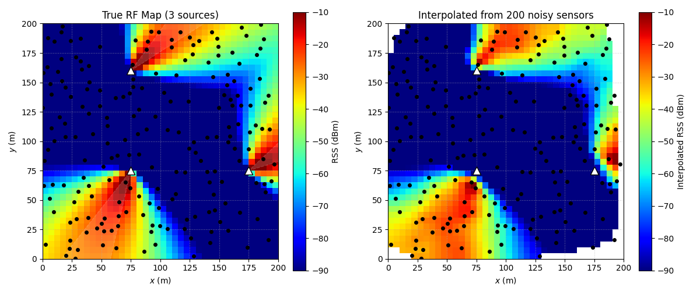

# Natural Neighbor Interpolation in Python
A manual Python implementation of 2D natural neighbor interpolation using Voronoi geometry and area-based interpolation weights.

## Functions

- `poly_area()`: Calculates polygon area.
- `clipped_voronoi()`: Computes Voronoi cells clipped to a polygon.
- `compute_natural_neighbor_weights()`: Calculates natural neighbor indices and interpolation weights.
- `natural_neighbor_map5()`: Performs interpolation over a 2D grid.

## Example Run

- **Grid resolution:** 40 × 40 points
- **Sensor points:** 200
- **Runtime:** Approximately 6 seconds on an Apple M4.

## AI Assistance

AI tools assisted with parts of the development process.
